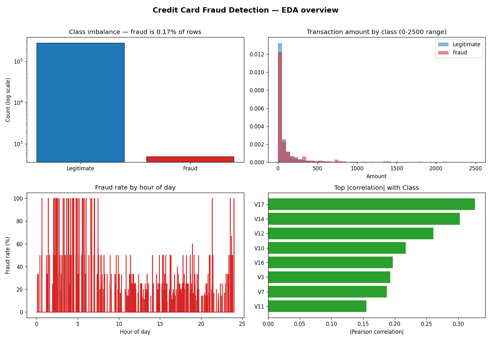
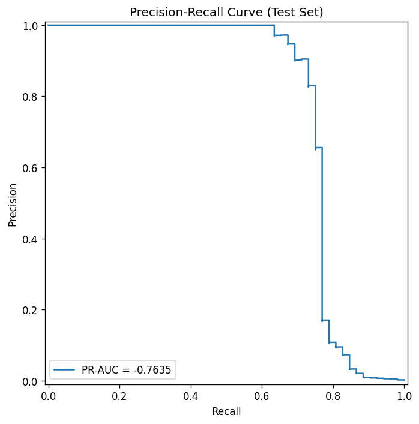
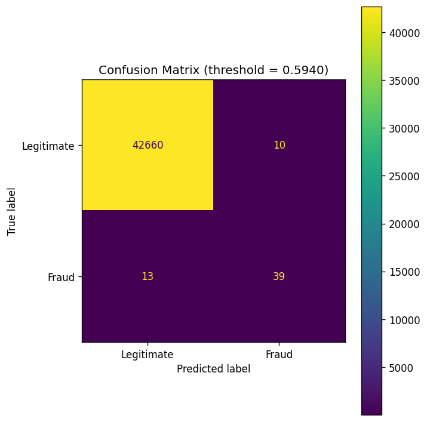
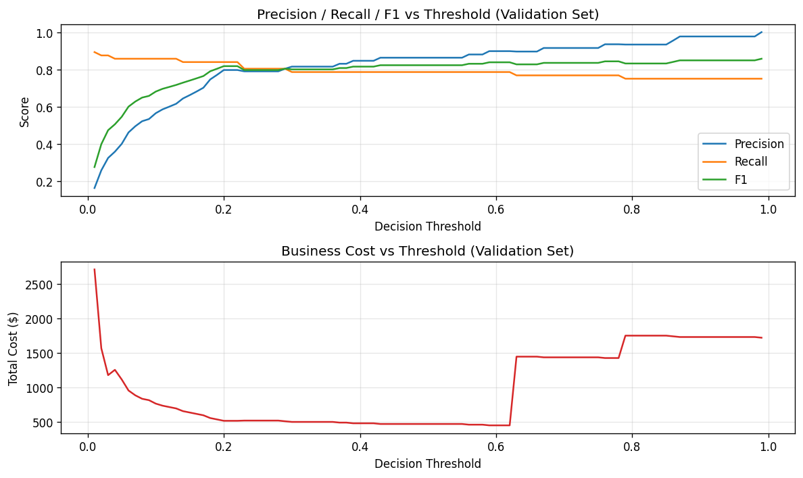
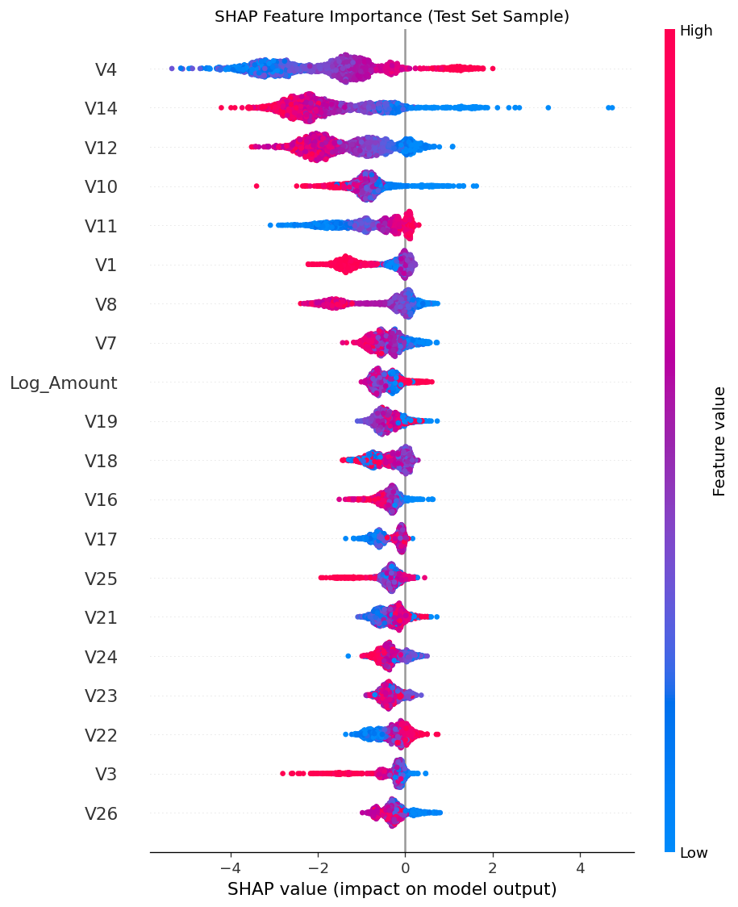

# Fraud Detection Platform

An end-to-end machine learning project that detects fraudulent credit card transactions, with temporal validation, class-imbalance handling, baseline comparison, threshold optimisation, explainability, and a FastAPI inference service.

**Final model:** class-weighted XGBoost (hyperparameters selected with `TimeSeriesSplit`) · **Primary metric:** PR-AUC **0.764** on the held-out test set.

| | |
|---|---|
| **Dataset** | [Kaggle Credit Card Fraud Detection](https://www.kaggle.com/datasets/mlg-ulb/creditcardfraud) — 284,807 transactions |
| **Fraud rate** | 0.173% (492 fraudulent) — severe class imbalance |
| **Model** | XGBoost inside a scikit-learn `Pipeline`, served via FastAPI |
| **Why PR-AUC** | With a ~578:1 imbalance, ROC-AUC is optimistic; PR-AUC reflects minority-class performance |
| **Test PR-AUC** | 0.764 (Logistic Regression baseline: 0.688) |
| **Test ROC-AUC** | 0.970 (Logistic Regression baseline: 0.977) |
| **Language / tooling** | Python 3.12, Poetry, pytest, Docker, GitHub Actions |

> This is a data-science portfolio project, not a production system. See [Limitations](#limitations) for an honest discussion of the trade-offs and the one result that did **not** generalise cleanly.

---

## Table of contents

1. [Problem](#1-problem)
2. [Dataset](#2-dataset)
3. [Why temporal splitting](#3-why-temporal-splitting)
4. [Data exploration](#4-data-exploration)
5. [Feature engineering](#5-feature-engineering)
6. [Handling class imbalance](#6-handling-class-imbalance)
7. [Baseline vs. XGBoost](#7-baseline-vs-xgboost)
8. [Hyperparameter tuning](#8-hyperparameter-tuning)
9. [Evaluation](#9-evaluation)
10. [Threshold optimisation](#10-threshold-optimisation)
11. [Explainability (SHAP)](#11-explainability-shap)
12. [API](#12-api)
13. [Reproducibility](#13-reproducibility)
14. [Docker](#14-docker)
15. [Testing](#15-testing)
16. [Project structure](#16-project-structure)
17. [Limitations](#limitations)

---

## 1. Problem

Credit card fraud detection is a **cost-sensitive, highly imbalanced binary classification** problem:

- Fraud is rare (~0.17% of transactions), so accuracy is meaningless (a "predict everything legitimate" model scores 99.8% accuracy and catches zero fraud).
- The cost of a **false negative** (missing fraud) is usually far higher than a **false positive** (a legitimate transaction flagged for review), because the second is a manual-review cost, not an automatic loss.
- Transactions arrive **in time order**, so a model deployed today must generalise to the future, not to randomly shuffled history.

These three facts drive every design decision in this repository.

## 2. Dataset

The project uses the well-known Kaggle "Credit Card Fraud Detection" dataset.

- 284,807 transactions over two days.
- Features `V1`–`V28` are PCA components (anonymised by the data publisher); `Time` (seconds since the first transaction) and `Amount` are the only original columns.
- `Class` is the target: `1` = fraud, `0` = legitimate.
- 492 fraudulent transactions (0.173%).

The raw CSV is **not** committed (it is ~144 MB). See [Reproducibility](#13-reproducibility) for how to obtain and place it.

## 3. Why temporal splitting

A standard random `train_test_split` would let the model train on transactions that occurred *after* the ones it is tested on. In a real fraud system that is impossible — you never score a transaction before you have seen history — and it produces an optimistic estimate of real-world performance because fraud patterns drift.

This project therefore splits **chronologically**:

| Split | Rows | Fraud | Fraud rate | Purpose |
|---|---|---|---|---|
| Train | 199,364 | 384 | 0.193% | Fit the model |
| Validation | 42,721 | 56 | 0.131% | Tune hyperparameters & choose the threshold |
| Test | 42,722 | 52 | 0.122% | Touched **once**, for final reporting |

The test set is held out from every modelling decision. Hyperparameter selection uses a `TimeSeriesSplit` inside cross-validation (see [Hyperparameter tuning](#8-hyperparameter-tuning)), and the decision threshold is chosen on the validation set only.

## 4. Data exploration

The exploratory analysis lives in [`notebooks/01_exploratory_data_analysis.ipynb`](notebooks/01_exploratory_data_analysis.ipynb) (executed with outputs committed). It answered three questions that directly shaped the pipeline:



- **Severe imbalance** → I optimise PR-AUC (not ROC-AUC) and weight the minority class during training.
- **Fraud amounts are not simply "large"** → the distributions overlap heavily, so `Amount` alone is a weak signal; the PCA features carry most of the discriminative power. This is why I keep all features rather than hand-picking.
- **Fraud rate varies over time** → another reason for chronological splitting and for the cyclical hour-of-day feature.

A compact version of the same panel is generated by [`scripts/build_eda_figure.py`](scripts/build_eda_figure.py).

## 5. Feature engineering

Feature engineering is done **inside the scikit-learn `Pipeline`** so it is fitted on training data only and applied identically at inference time (no leakage, no train/serve skew). Two custom transformers live in [`src/features/engineering.py`](src/features/engineering.py):

- **`TemporalFeatureExtractor`** — derives cyclical `hour_sin` / `hour_cos` features from `Time` so the model can learn daily patterns without treating 23:00 and 00:00 as distant.
- **`LogAmountTransformer`** — replaces `Amount` with `log1p(Amount)` because the raw amount is heavily right-skewed.

A `StandardScaler` then standardises all numeric features. All final features (28 PCA + engineered time features + log-amount) are retained.

## 6. Handling class imbalance

The original configuration used `scale_pos_weight=1.0`, i.e. it ignored the imbalance entirely. This project computes the weight **from the training split only** (never from validation or test):

```
scale_pos_weight = n_negative_train / n_positive_train
                = 198,980 / 384
                ≈ 518.2
```

This is implemented in [`src/models/trainer.py`](src/models/trainer.py) (`compute_scale_pos_weight`) and is not hardcoded, so it stays correct if the dataset or split ratios change. A unit test asserts the value is derived from training labels only.

The Logistic Regression baseline instead uses `class_weight="balanced"`, scikit-learn's idiomatic equivalent for linear models.

## 7. Baseline vs. XGBoost

A model is only worth its complexity if it beats a simple, well-tuned baseline. I therefore train **Logistic Regression** (with `class_weight="balanced"`) and **XGBoost** on the identical splits, through the identical preprocessing, and score both with the identical cost-aware threshold search.

Final test-set results (each at its own validation-selected threshold):

| Model | ROC-AUC | PR-AUC | Precision | Recall | F1 | Threshold | Total cost |
|---|---|---|---|---|---|---|---|
| Logistic Regression | **0.977** | 0.688 | 0.433 | 0.750 | 0.549 | 0.990 | $2,882 |
| **XGBoost (selected)** | 0.970 | **0.764** | **0.796** | 0.750 | **0.772** | 0.594 | **$2,472** |

**Why XGBoost is the right choice here — and an honest caveat.** XGBoost wins on the primary metric, PR-AUC (0.764 vs 0.688), and translates that into materially better precision (0.80 vs 0.43) at the same 75% recall, cutting false positives from 51 to 10 and total cost from $2,882 to $2,472. Notably, **Logistic Regression actually achieves a slightly higher ROC-AUC** (0.977 vs 0.970). This is a common and instructive result on this dataset: ROC-AUC is dominated by the huge number of easy negatives, so a linear model can look competitive on ROC-AUC while being much weaker on the minority class that matters (PR-AUC). It is a concrete justification for prioritising PR-AUC in imbalanced problems.

## 8. Hyperparameter tuning

Tuning uses `GridSearchCV` over a **small, deliberately modest** grid (16 combinations):

| Parameter | Values |
|---|---|
| `max_depth` | 3, 5 |
| `learning_rate` | 0.05, 0.1 |
| `n_estimators` | 100, 200 |
| `subsample` | 0.8, 1.0 |

Cross-validation uses **`TimeSeriesSplit(n_splits=3)`**, not `StratifiedKFold`. A stratified shuffle would mix future transactions into earlier folds and leak information about the future into model selection — exactly what the temporal split is designed to prevent. `TimeSeriesSplit` guarantees each fold only trains on data chronologically before its validation window. The test set is never used during tuning. A unit test guards against regressing to a shuffled CV.

Selected parameters (best CV PR-AUC = 0.791):

```
learning_rate = 0.1, max_depth = 5, n_estimators = 200, subsample = 0.8
```

The search grid is kept small on purpose: the goal is a defensible, explainable model, not a marginal leaderboard gain.

## 9. Evaluation

The evaluation report distinguishes the **validation** phase (used for threshold selection) from the **final test** phase (used once). It is regenerated by the pipeline at `reports/evaluation_report.md` and includes ROC-AUC, PR-AUC, precision, recall, F1, the confusion matrix, the PR curve, and threshold sensitivity curves.



Final test-set confusion matrix at the selected threshold (0.594):



| | |
|---|---|
| True negatives (legit, not flagged) | 42,660 |
| False positives (legit, flagged for review) | 10 |
| False negatives (fraud, missed) | 13 |
| True positives (fraud, caught) | 39 |

**Error analysis** (`results/error_analysis.json`): the model's misses are not random. Missed fraud (false negatives) had a **low average amount (~$182)**, while false positives skewed toward a few high-value legitimate transactions (median only ~$1.50 but average ~$2,639, i.e. a small number of large outliers). This is consistent with a model that has learned strong structural signals but can still be fooled by unusual high-value legitimate activity.


## 10. Threshold optimisation

Instead of a fixed 0.5 cutoff, the decision threshold is chosen by **minimising an explicit business cost** on the validation set:

```
cost = (false_positives × $10)  +  (false_negatives × 1.0 × transaction_amount)
```

The $10 review cost and the 1.0× multiplier on missed-fraud amount are **hypothetical** assumptions, chosen to make the trade-off concrete and adjustable (see `configs/config.yaml`). The threshold is selected on validation and then frozen.



**An honest finding — the threshold does not fully generalise.** On validation, the cost-optimal threshold was 0.594 with a total cost of **$453**. Applied to the held-out test set, the same threshold yields a total cost of **$2,472** — a much larger absolute cost than the validation curve predicted. The cause is that the **average amount of missed fraud differs substantially between periods**: missed fraud in the test window is worth more on average (~$182) than in the validation window, so the same number of missed cases is far more expensive. In other words, the cost curve is sensitive to the dollar mix of fraud in each period, and the validation period happened to contain cheaper fraud.

This is reported rather than hidden or "tuned away". It is a genuine limitation of threshold selection on a single short validation window, and it motivates monitoring and periodic re-selection in any real deployment.

## 11. Explainability (SHAP)

[`src/evaluate/explainability.py`](src/evaluate/explainability.py) uses SHAP's `TreeExplainer` to produce a **global** feature-importance summary on a sample of the test set, saved to `reports/shap_summary.png`. The summary is computed on transformed feature names so the plotted labels match what the model actually sees.



The single-prediction explanation path is kept simple (the API returns the fraud probability and the applied threshold). I deliberately did **not** build a per-prediction explanation endpoint or service, because it would add complexity without changing the modelling story.

## 12. API

A minimal FastAPI service ([`src/api/main.py`](src/api/main.py)) loads the persisted pipeline and exposes:

- `GET /health` → `{"status": "ok", "model_loaded": true, "threshold": 0.594}`
- `POST /predict` → returns `fraud_probability`, `is_fraud`, and the `applied_threshold`.

Input is validated with Pydantic (a negative `Amount` or a missing feature returns `422`). Internal exceptions are caught and returned as a generic `500` without leaking stack traces.

Run it locally (after training the model — see below):

```bash
poetry run uvicorn src.api.main:app --host 0.0.0.0 --port 8000
```

Then open http://localhost:8000/docs for the interactive Swagger UI.

## 13. Reproducibility

### 1. Install dependencies

Python 3.12 and [Poetry](https://python-poetry.org/) are required.

```bash
poetry install
```

### 2. Get the dataset

Download `creditcard.csv` from [Kaggle](https://www.kaggle.com/datasets/mlg-ulb/creditcardfraud) and place it at `data/raw/creditcard.csv`:

```bash
mkdir -p data/raw
cp ~/Downloads/creditcard.csv data/raw/
```

### 3. Train and evaluate

This runs the full pipeline: temporal split → feature engineering → Logistic Regression + XGBoost → hyperparameter tuning → threshold optimisation → evaluation → SHAP → saves `models/fraud_pipeline.pkl` and `models/metrics.json`.

```bash
poetry run python scripts/run_pipeline.py
```

The hyperparameter grid takes ~10 minutes on a laptop CPU; the rest is seconds. Results are deterministic — a fixed `random_state=42` and chronological splitting reproduce the exact numbers above.

### 4. Serve the model

```bash
poetry run uvicorn src.api.main:app --host 0.0.0.0 --port 8000
```

### 5. Run the tests

```bash
poetry run pytest tests/ -v
```


## 14. Docker

The model artifact (`models/fraud_pipeline.pkl`) is intentionally **not** baked into the image and not committed to git. The workflow is: **train locally, then mount the artifact into the container**.

```bash
# Build the image and run, mounting the locally-trained model directory
docker-compose up --build
```

The container's entrypoint (`scripts/start_api.sh`) checks that the model exists and prints the exact command to generate it if it is missing.

```bash
# Verify (from the host while the container is running)
curl http://localhost:8000/health
curl -X POST http://localhost:8000/predict \
  -H "Content-Type: application/json" \
  -d '{"Time":100000.0,"Amount":50.0,"V1":-0.5,"V2":0.2,"V3":1.1,"V4":-0.3,"V5":0.8,"V6":-0.2,"V7":0.5,"V8":0.1,"V9":-0.4,"V10":0.3,"V11":-0.6,"V12":0.2,"V13":-0.5,"V14":0.7,"V15":-0.2,"V16":0.4,"V17":-0.3,"V18":0.6,"V19":-0.1,"V20":0.2,"V21":-0.4,"V22":0.5,"V23":-0.2,"V24":0.3,"V25":-0.5,"V26":0.1,"V27":-0.3,"V28":0.2}'
```

## 15. Testing

The suite uses small **synthetic** datasets and runs in seconds — it never downloads the Kaggle file.

```bash
poetry run pytest tests/ -v
```

Coverage includes: temporal splitting, feature transformers, `scale_pos_weight` computed from training labels only, metric/business-cost computation, threshold optimisation, `TimeSeriesSplit` guard in tuning, model prediction, the API success path, invalid input (`422`), model-loading failure, and an end-to-end synthetic pipeline run.

## 16. Project structure

```
├── configs/config.yaml          # split sizes, model params, tuning grid, business costs
├── notebooks/                   # executed EDA notebook
├── scripts/
│   ├── run_pipeline.py          # train → tune → threshold → evaluate → explain → save
│   ├── build_eda_figure.py      # regenerates docs/figures/eda_overview.png
│   └── start_api.sh             # container entrypoint (checks model exists)
├── src/
│   ├── data/ingestion.py        # chronological train/val/test split
│   ├── features/engineering.py  # TemporalFeatureExtractor, LogAmountTransformer
│   ├── models/
│   │   ├── trainer.py           # scale_pos_weight, pipeline, GridSearchCV tuning
│   │   └── thresholding.py      # cost-aware threshold optimisation
│   ├── evaluate/
│   │   ├── metrics.py           # classification + business-cost metrics
│   │   ├── reporting.py         # evaluation report + PR curve + confusion matrix
│   │   └── explainability.py    # SHAP summary
│   └── api/                     # FastAPI app + Pydantic schemas
├── tests/                       # pytest suite (synthetic data)
├── docs/figures/                # committed figures referenced by this README
└── Dockerfile / docker-compose.yml
```

## Limitations

This project is a portfolio demonstration, and it is important to be precise about what it does and does not show.

- **The business cost model is hypothetical.** The $10 false-positive cost and the 1.0× multiplier on missed-fraud amount are assumptions to make the trade-off concrete, not measured operational figures. Real cost numbers would change the optimal threshold.
- **Threshold generalisation is imperfect.** The validation-optimal threshold produced a much larger absolute cost on test than the validation curve predicted, because the dollar mix of missed fraud differs between periods (see [Threshold optimisation](#10-threshold-optimisation)). The threshold is evidence-based but not robust across periods, and would need re-selection and monitoring in any real system.
- **Two days of data.** The dataset spans ~48 hours, so "temporal generalisation" here is generalising across hours, not across months or seasons. Fraud patterns evolve on longer timescales than this data captures.
- **Anonymised features.** `V1`–`V28` are PCA components, so I cannot build interpretable, domain-level features (e.g. merchant category, location) or reason about specific real-world fraud mechanisms.
- **Not a production system.** The API is a single-process inference service with no authentication, no model monitoring, no drift detection, and no retraining loop. It is suitable for demonstration, not deployment.
- **Baseline honesty.** Logistic Regression achieves a comparable (slightly higher) ROC-AUC. XGBoost is justified by PR-AUC and business cost, not by ROC-AUC alone.

---

## Acknowledgements

Dataset: [Credit Card Fraud Detection](https://www.kaggle.com/datasets/mlg-ulb/creditcardfraud) (Machine Learning Group, Université Libre de Bruxelles), available under the Database Contents License (DbCL) v1.0.

